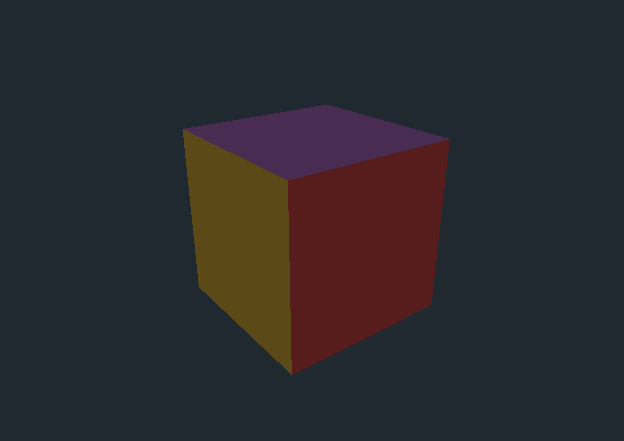

# Real Direct3D inside WPF, the airspace way

> A walk-through of putting a live **Direct3D 11** scene inside a WPF window by giving Direct3D its own
> Win32 child window through a `WindowsFormsHost`. We build a spinning, lit cube with a modern
> programmable pipeline — device, swap chain, shaders, a depth buffer — and talk about the *airspace*
> rule that makes this technique both simple and limited.

*By Richard Potter. The source discussed here lives in this repository under `src/DirectXCube/`.*



**Contents**

- [Introduction](#introduction)
- [Two ways to mix Direct3D and WPF](#two-ways-to-mix-direct3d-and-wpf)
- [Giving Direct3D a window to live in](#giving-direct3d-a-window-to-live-in)
- [Bringing up the device and swap chain](#bringing-up-the-device-and-swap-chain)
- [A cube is six faces of two triangles](#a-cube-is-six-faces-of-two-triangles)
- [Shaders: transform and light](#shaders-transform-and-light)
- [Depth, not winding](#depth-not-winding)
- [Driving the frames](#driving-the-frames)
- [Airspace: the catch](#airspace-the-catch)
- [Running it](#running-it)
- [Going further](#going-further)
- [Summary](#summary)

---

## Introduction

This started life as a 2009-era demo that hosted **Managed DirectX 1.0** inside WPF. Managed DirectX
was Microsoft's first .NET wrapper over DirectX; it was deprecated almost immediately, replaced by XNA,
and the assemblies it depended on (`Microsoft.DirectX.Direct3D`) cannot be referenced from modern .NET
at all. The original project no longer builds on anything you can install today.

The *idea* it was demonstrating is still completely valid, though: **take a real Direct3D scene and
embed it in a WPF window.** This rewrite keeps that idea and brings it to **.NET 10** using
[**Vortice.Windows**](https://github.com/amerkoleci/Vortice.Windows) — the actively-maintained,
low-overhead set of .NET bindings for the whole of DirectX. Vortice is the spiritual successor to
Managed DirectX → SlimDX → SharpDX, and it tracks current Direct3D 11/12 closely.

If you want to learn WPF's *own* built-in 3D instead (no DirectX, no native interop), see the sibling
project [**WpfCube**](https://github.com/dickiepotter/WpfCube). This project is about the opposite
choice: bringing the *real* DirectX pipeline into a WPF app.

## Two ways to mix Direct3D and WPF

There are two established techniques, and they are worth naming up front because they trade off in
opposite directions:

1. **`WindowsFormsHost` + a child HWND** — give Direct3D its own native window nested inside the WPF
   one. Dead simple, full GPU performance, and you use Direct3D exactly as you would in a native app.
   The cost is *airspace*: that rectangle is a separate window that always sits **on top** of WPF
   content and cannot be made transparent, rotated, or layered with WPF elements.
2. **`D3DImage`** — render to an off-screen Direct3D surface and hand it to WPF as an `ImageSource`, so
   it composites like any other image. No airspace limits, but more interop plumbing and a copy per
   frame. That technique is demonstrated in the sibling project
   [**D3DImageCube**](https://github.com/dickiepotter/D3DImageCube).

**This** project takes route 1. It is the right choice when the 3D view fills a region of its own — a
viewport, a preview pane, a game surface — and you don't need WPF chrome floating over it.

## Giving Direct3D a window to live in

Direct3D 11 presents to an `HWND` — a Win32 window handle. WPF doesn't hand those out for arbitrary
elements, so we borrow one from Windows Forms. [`MainWindow.xaml`](src/DirectXCube/MainWindow.xaml) is
almost empty:

```xml
<WindowsFormsHost x:Name="Host" />
```

and the code-behind drops a WinForms `Panel` inside it. A `Panel` is just a rectangle, but crucially it
*has an HWND*, and `Panel.Handle` is exactly what the swap chain needs
([`MainWindow.xaml.cs`](src/DirectXCube/MainWindow.xaml.cs)):

```csharp
Host.Child = _panel;                 // WinForms control inside the WPF tree
Host.Loaded += OnHostLoaded;         // wait until the HWND really exists
...
_renderer.Initialize(_panel.Handle, _panel.ClientSize.Width, _panel.ClientSize.Height);
```

We initialise on `Loaded` because the handle isn't created until the control is realised.

## Bringing up the device and swap chain

Three objects do the heavy lifting in Direct3D 11, all created in
[`CubeRenderer.cs`](src/DirectXCube/CubeRenderer.cs):

- the **device**, which creates GPU resources;
- the **device context**, which records drawing commands;
- the **swap chain**, which owns the back buffer and shows finished frames in our HWND.

```csharp
D3D11CreateDevice(null, DriverType.Hardware, DeviceCreationFlags.BgraSupport,
    [FeatureLevel.Level_11_0, FeatureLevel.Level_10_0], out _device, out _context).CheckError();

using var dxgiFactory = CreateDXGIFactory1<IDXGIFactory2>();
_swapChain = dxgiFactory.CreateSwapChainForHwnd(_device, hwnd, swapChainDescription);
```

`CreateSwapChainForHwnd` is the modern (DXGI 1.2) entry point and is what binds the GPU output to the
WinForms panel. We use a `FlipDiscard` swap effect with two buffers — the model Windows wants today.

## A cube is six faces of two triangles

All GPU geometry is triangles. A cube is six square faces, and each square is two triangles sharing a
diagonal. Rather than type out 36 vertices by hand, the geometry is described as **data** — per face: a
normal, a colour and four corners — and expanded in a loop:

```
   D --- C        positions: A B C D
   |  \  |        triangle 1: A B C
   A --- B        triangle 2: A C D
```

Each vertex carries its position, its face normal (for lighting) and a colour. Those three fields are
declared once as an **input layout** so the GPU knows how to read the vertex buffer:

```csharp
_inputLayout = _device.CreateInputLayout(
[
    new InputElementDescription("POSITION", 0, Format.R32G32B32_Float, 0, 0),
    new InputElementDescription("NORMAL",   0, Format.R32G32B32_Float, 12, 0),
    new InputElementDescription("COLOR",    0, Format.R32G32B32A32_Float, 24, 0),
], vsBlob.Span);
```

## Shaders: transform and light

Unlike the old fixed-function pipeline, Direct3D 11 has no built-in lighting — you write it. The HLSL
here is deliberately tiny: a vertex shader that projects each point and rotates its normal into world
space, and a pixel shader that does one directional light plus ambient:

```hlsl
PSInput VS(VSInput input)
{
    PSInput o;
    o.pos = mul(float4(input.pos, 1.0), WorldViewProjection);
    o.nrm = mul(input.nrm, (float3x3)World);
    o.col = input.col;
    return o;
}

float4 PS(PSInput input) : SV_TARGET
{
    float3 n = normalize(input.nrm);
    float diffuse = saturate(dot(n, -normalize(LightDirection.xyz)));
    float intensity = saturate(0.38 + 0.8 * diffuse); // ambient + directional
    return float4(input.col.rgb * intensity, 1.0);
}
```

The transforms are computed on the CPU with `System.Numerics` and pushed once per frame in a **constant
buffer**. `System.Numerics.Matrix4x4` is row-major and uses row-vector multiplication, which is why the
HLSL declares the matrices `row_major` and writes `mul(vector, matrix)` rather than the other way
round — a classic source of "my cube is inside-out / squashed" confusion.

## Depth, not winding

The first 3D cube everyone writes has faces that vanish from some angles. There are two causes — wrong
triangle **winding** (so back-face culling eats the faces you wanted) and no **depth test** (so far
faces paint over near ones). This demo sidesteps the winding trap entirely:

```csharp
_rasterizerState = _device.CreateRasterizerState(new RasterizerDescription
{
    FillMode = FillMode.Solid,
    CullMode = CullMode.None,     // draw both sides; winding can't make a face disappear
});
```

With culling off, correctness rests on the **depth buffer** instead. We clear it to 1.0 each frame and
let the GPU keep, per pixel, whichever fragment is nearest the camera. For an opaque convex shape that
is all you need, and it is robust no matter which way the triangles wind.

## Driving the frames

WPF has a per-composition heartbeat, `CompositionTarget.Rendering`, and we simply render one Direct3D
frame each time it ticks:

```csharp
CompositionTarget.Rendering += OnRendering;
...
private void OnRendering(object? sender, EventArgs e)
    => _renderer.Render((float)_clock.Elapsed.TotalSeconds);
```

`Render` updates the constant buffer with a fresh rotation, clears the colour and depth targets, binds
the pipeline, issues a single `Draw`, and calls `Present(1, …)` to put the frame on screen in sync with
the monitor.

## Airspace: the catch

The price of route 1 is *airspace*. The WinForms panel is a separate top-level surface owned by the
window manager, so it is always drawn **over** the WPF layer. You cannot put a semi-transparent WPF
overlay, a `Popup`, or an animated WPF control *on top of* the 3D view — they'll be hidden by it. If you
need that, you want `D3DImage` (the [D3DImageCube](https://github.com/dickiepotter/D3DImageCube)
sibling) instead. For a self-contained viewport like this one, airspace simply doesn't bite.

## Running it

Requires the [.NET 10 SDK](https://dotnet.microsoft.com/download) (or newer) on Windows with a
Direct3D 11-capable GPU.

```bash
cd src/DirectXCube
dotnet run
```

A window opens with the cube tumbling about two axes. To regenerate the screenshot in this README
headlessly:

```bash
dotnet run -- --capture ../../docs/images/cube.png
```

That flag renders a few frames, reads the back buffer straight off the GPU, writes the PNG and exits.

## Going further

- **Add a second light** or a specular term in the pixel shader for a glossier look.
- **Index the geometry** with an index buffer to share the eight corner positions instead of 36
  vertices (you'll need per-vertex normals or a geometry shader to keep faces flat-shaded).
- **Handle resize** for real DPI changes — the renderer already calls `ResizeBuffers`; wire it to the
  panel's `SizeChanged` for live resizing.
- **Try `D3DImage`** and compare: same cube, no airspace, one GPU copy per frame.
- **Move to Direct3D 12** — Vortice covers it too — if you want to see the explicit command-list model.

## Summary

Hosting real Direct3D in WPF through a `WindowsFormsHost` is the shortest path to full GPU rendering
inside a managed desktop app: borrow an HWND from a WinForms `Panel`, point a DXGI swap chain at it, and
drive frames off `CompositionTarget.Rendering`. Modern DirectX has no fixed-function lighting, so you
write a few lines of HLSL and push your matrices through a constant buffer — remembering that
`System.Numerics` is row-major. Lean on the **depth buffer** rather than fragile winding to get a solid
cube, and keep **airspace** in mind: this technique is perfect for a dedicated 3D region and the wrong
tool the moment you need WPF content floating over the scene.
